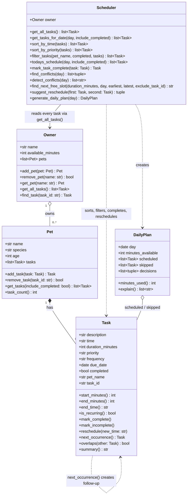

# 🐾 PawPal+

**PawPal+** is a pet care planner for busy owners. It tracks feedings, walks, medications and appointments for several pets, then uses a small set of scheduling algorithms to sort the day, filter what you care about, roll recurring tasks forward, warn you about clashes, and build a daily plan that fits the time you actually have.

The project follows a **CLI-first** workflow: all logic lives in `pawpal_system.py`, is verified with a terminal demo (`main.py`) and a `pytest` suite, and is then wired into a Streamlit UI (`app.py`).

## ✨ Features

- **Multi-pet owner model:** one `Owner` manages many `Pet`s; `Owner.get_all_tasks()` returns every pet's tasks in one list, and the `Scheduler` reads exclusively through it.
- **Sorting by time:** `Scheduler.sort_by_time()` orders tasks by date, then `HH:MM` start time. Times are normalized (`"7:30"` → `"07:30"`) so string sorting is always chronological.
- **Sorting by priority:** `Scheduler.sort_by_priority()` puts high → medium → low and breaks ties by start time.
- **Filtering:** `Scheduler.filter_tasks(pet_name=..., completed=...)` filters by pet (case-insensitive), by status, or both. `Scheduler.todays_schedule(day)` gives one day's sorted agenda.
- **Daily and weekly recurrence:** `Scheduler.mark_task_complete()` completes a task and, for `daily`/`weekly` tasks, automatically adds the next occurrence (`due_date + timedelta(days=1)` or `weeks=1`) to the same pet.
- **Conflict warnings:** `Scheduler.detect_conflicts()` flags any two pending tasks on the same day whose time windows overlap (start + duration), for the same pet or across pets. It returns warning strings and never crashes the app.
- **Conflict fix suggestions:** `Scheduler.suggest_reschedule()` picks the lower-priority task of a clashing pair and finds its next free slot with `Scheduler.find_next_free_slot()`. The UI offers it as a one-click button.
- **Time-budget daily plan:** `Scheduler.generate_daily_plan()` fills the owner's `available_minutes` with pending tasks, highest priority first, and returns a `DailyPlan` with what fits, what got skipped, and a one-line reason for each decision.
- **Input validation:** `Task` rejects bad times (`"25:00"`, `"8am"`), unknown priorities/frequencies, blank descriptions and non-positive durations with a clear `ValueError`.
- **Streamlit UI with memory:** the `Owner` lives in `st.session_state`, so pets and tasks survive every rerun.

## 🚀 Getting started

```bash
python -m venv .venv
source .venv/bin/activate        # Windows PowerShell: .\.venv\Scripts\Activate.ps1
pip install -r requirements.txt

python main.py                   # CLI demo
streamlit run app.py             # web UI
python -m pytest                 # test suite
```

## 🏗️ Implementation summary

| Class | Responsibility |
|-------|----------------|
| `Task` (dataclass) | One activity: `description`, `time` (`HH:MM`), `duration_minutes`, `priority`, `frequency` (`once`/`daily`/`weekly`), `due_date`, `completed`, `pet_name`, `task_id`. Validates itself, knows its start/end minutes, can `mark_complete()`, `reschedule()`, check `overlaps()` and build its `next_occurrence()`. |
| `Pet` (dataclass) | A pet's details plus its `tasks`. `add_task()` stamps the pet's name on the task so a flat task list still knows which pet each task belongs to. |
| `Owner` (dataclass) | The person, their daily `available_minutes` budget, and their `pets`. `get_all_tasks()` flattens every pet's tasks; `get_pet()` / `find_task()` look things up. |
| `Scheduler` | The "brain." Holds a reference to an `Owner`, pulls tasks through `Owner.get_all_tasks()`, and implements sorting, filtering, recurrence, conflict detection, free-slot search and plan generation. |
| `DailyPlan` (dataclass) | The result of `generate_daily_plan()`: scheduled tasks (in time order), skipped tasks, and the reasoning behind each decision. |

**How they work together:** the UI or CLI creates an `Owner`, adds `Pet`s with `Owner.add_pet()`, and attaches `Task`s with `Pet.add_task()`. A `Scheduler(owner)` never stores tasks of its own. Every query starts from `owner.get_all_tasks()`, so a task added to any pet shows up in sorting, filtering, conflict checks and plans immediately. When a recurring task is completed through `Scheduler.mark_task_complete()`, the task builds its own follow-up (`Task.next_occurrence()`) and the scheduler hands it to the right pet.



Mermaid sources: [`diagrams/uml_draft.mmd`](diagrams/uml_draft.mmd) (Phase 1 draft) and [`diagrams/uml_final.mmd`](diagrams/uml_final.mmd) (final; identical copy kept in `diagrams/uml.mmd`).

## 🧠 Smarter Scheduling

| Feature | Method(s) | How it works |
|---------|-----------|--------------|
| Task sorting | `Scheduler.sort_by_time()`, `Scheduler.sort_by_priority()` | `sorted()` with a `lambda` key: `(due_date, time)` for chronological order; `(-priority_rank, due_date, time)` for priority order. `Task.__post_init__` zero-pads times so `"9:00"` can't sort after `"10:00"`. |
| Filtering | `Scheduler.filter_tasks()`, `Scheduler.get_tasks_for_date()`, `Scheduler.todays_schedule()` | Optional `pet_name` (case-insensitive) and `completed` filters that can be combined; date filtering keeps tomorrow's recurring copies out of today's view. |
| Conflict handling | `Scheduler.find_conflicts()`, `Scheduler.detect_conflicts()`, `Task.overlaps()` | Sort the day's pending tasks by start, then sweep: compare each task only with tasks that start before it ends. Overlap rule: `a.start < b.end and b.start < a.end`, so back-to-back tasks (08:00–08:30 then 08:30) are fine. Returns warning strings instead of raising. |
| Conflict fixes | `Scheduler.suggest_reschedule()`, `Scheduler.find_next_free_slot()`, `Task.reschedule()` | Moves the lower-priority task of a pair (ties: the later one) to the earliest gap long enough for it, between 06:00 and 22:00. |
| Recurring tasks | `Scheduler.mark_task_complete()`, `Task.next_occurrence()` | Marks the task done; for `daily`/`weekly` uses `timedelta` to create a fresh pending copy on the next due date with a new `task_id`. Completing the same task twice does not create duplicates. |
| Time-budget plan | `Scheduler.generate_daily_plan()`, `DailyPlan.explain()` | Greedy: walk pending tasks in priority order, place each one that still fits the owner's `available_minutes`, skip the rest, then show the placed tasks in time order with reasons. |

## 🧪 Testing PawPal+

```bash
python -m pytest
```

The suite in `tests/test_pawpal.py` (32 tests) covers:

- **Basics:** `mark_complete()` flips status; `Pet.add_task()` increases the task count and stamps the pet name.
- **Validation:** time normalization and rejection of bad times, priorities, frequencies, durations and blank descriptions.
- **Multi-pet access:** `Owner.get_all_tasks()` spans every pet; duplicate pet names are rejected; a pet with no tasks yields an empty schedule, no conflicts and an empty plan.
- **Sorting correctness:** chronological order across pets, single-digit hours (`9:00` vs `10:00`), date-before-time ordering, and priority ordering with time tie-breaks.
- **Filtering:** by pet (case-insensitive), by completion status, combined, and by date.
- **Recurrence:** daily → next day, weekly → +7 days, one-off → nothing, and no duplicates when completing twice.
- **Conflict detection:** identical start times across pets, overlapping durations for the same pet, back-to-back tasks *not* flagged, completed/other-day tasks ignored, every pair reported in a three-way clash, the reschedule suggestion resolves the clash, and a full day returns no free slot.
- **Daily plan:** respects the time budget, places high priority first, and explains every decision.

Sample run:

```
============================= test session starts ==============================
platform linux -- Python 3.13.18, pytest-9.1.1, pluggy-1.6.0 -- /usr/local/bin/python3
rootdir: /tmp/ai110-module2show-pawpal-starter
configfile: pytest.ini
testpaths: tests
plugins: platformdirs-4.13.5, anyio-4.15.1
collecting ... collected 32 items

tests/test_pawpal.py::test_mark_complete_changes_status PASSED           [  3%]
tests/test_pawpal.py::test_adding_task_increases_pet_task_count PASSED   [  6%]
tests/test_pawpal.py::test_time_is_normalized_to_zero_padded_hhmm PASSED [  9%]
tests/test_pawpal.py::test_invalid_task_fields_raise_value_error[hour-25] PASSED [ 12%]
tests/test_pawpal.py::test_invalid_task_fields_raise_value_error[am-pm-format] PASSED [ 15%]
tests/test_pawpal.py::test_invalid_task_fields_raise_value_error[unknown-priority] PASSED [ 18%]
tests/test_pawpal.py::test_invalid_task_fields_raise_value_error[unknown-frequency] PASSED [ 21%]
tests/test_pawpal.py::test_invalid_task_fields_raise_value_error[zero-duration] PASSED [ 25%]
tests/test_pawpal.py::test_invalid_task_fields_raise_value_error[blank-description] PASSED [ 28%]
tests/test_pawpal.py::test_get_all_tasks_collects_tasks_from_every_pet PASSED [ 31%]
tests/test_pawpal.py::test_duplicate_pet_names_are_rejected PASSED       [ 34%]
tests/test_pawpal.py::test_pet_with_no_tasks_produces_empty_results PASSED [ 37%]
tests/test_pawpal.py::test_sort_by_time_returns_chronological_order PASSED [ 40%]
tests/test_pawpal.py::test_sort_by_time_handles_single_digit_hours PASSED [ 43%]
tests/test_pawpal.py::test_sort_by_time_orders_by_date_first PASSED      [ 46%]
tests/test_pawpal.py::test_sort_by_priority_puts_high_first_and_breaks_ties_by_time PASSED [ 50%]
tests/test_pawpal.py::test_filter_by_pet_name_is_case_insensitive PASSED [ 53%]
tests/test_pawpal.py::test_filter_by_completion_status PASSED            [ 56%]
tests/test_pawpal.py::test_filter_by_pet_and_status_combined PASSED      [ 59%]
tests/test_pawpal.py::test_todays_schedule_excludes_other_dates PASSED   [ 62%]
tests/test_pawpal.py::test_completing_daily_task_creates_task_for_next_day PASSED [ 65%]
tests/test_pawpal.py::test_completing_weekly_task_creates_task_one_week_later PASSED [ 68%]
tests/test_pawpal.py::test_completing_one_off_task_creates_nothing PASSED [ 71%]
tests/test_pawpal.py::test_completing_same_task_twice_does_not_duplicate PASSED [ 75%]
tests/test_pawpal.py::test_detects_duplicate_times_across_pets PASSED    [ 78%]
tests/test_pawpal.py::test_detects_overlapping_durations_for_same_pet PASSED [ 81%]
tests/test_pawpal.py::test_back_to_back_tasks_do_not_conflict PASSED     [ 84%]
tests/test_pawpal.py::test_conflicts_ignore_completed_tasks_and_other_days PASSED [ 87%]
tests/test_pawpal.py::test_three_way_overlap_reports_every_pair PASSED   [ 90%]
tests/test_pawpal.py::test_suggest_reschedule_moves_lower_priority_task_to_next_free_slot PASSED [ 93%]
tests/test_pawpal.py::test_find_next_free_slot_returns_none_when_day_is_full PASSED [ 96%]
tests/test_pawpal.py::test_daily_plan_respects_time_budget_and_priority PASSED [100%]

============================== 32 passed in 0.07s ==============================
```

**Confidence level: ★★★★☆ (4/5).** Every scheduling rule has happy-path and edge-case tests, and the CLI demo exercises the same code end to end. One star is held back because the Streamlit UI was smoke-tested by hand rather than by automated UI tests, and a few edge cases are knowingly out of scope (tasks that cross midnight, overdue recurring tasks, persistence between sessions).

## 📸 Demo Walkthrough

### Main UI features (`streamlit run app.py`)

- **Sidebar:** set the owner's name and the minutes available for pet care per day; **Load demo data** (the same owner and pets as `main.py`) or **Reset everything**.
- **Metrics row:** pets, tasks today, pending today, and conflicts today at a glance.
- **➕ Add a pet:** name, species and age → `Owner.add_pet()`. Duplicate names show an error instead of crashing.
- **🗓️ Schedule a task:** pet, description, start time, duration, priority, repeat (once/daily/weekly) and date → `Pet.add_task()`. If the new task overlaps another, the confirmation turns into a warning right away.
- **📅 Schedule:** pick a day, filter by pet and status, and sort by time or priority (`filter_tasks()` + `sort_by_time()` / `sort_by_priority()`). Each conflict appears as an `st.warning` with a **Move … to HH:MM** button from `suggest_reschedule()`. With no clashes you get an `st.success`. Pick any pending task to **✅ Mark complete** (recurring tasks roll forward) or **🗑️ Remove** it.
- **🧠 Daily plan:** a progress bar for minutes used vs. available, an `st.table` of the tasks that fit, a warning listing what didn't fit, and a "Why this plan?" list of reasons.

### Example workflow

1. Set the owner name to *Jordan* and the budget to *150* minutes in the sidebar.
2. Add **Mochi** (dog, 3) and **Luna** (cat, 5) in *Add a pet*; both appear in *Your pets* with 0 tasks.
3. Schedule Mochi's *Morning walk* at 08:00 for 30 min, high priority, daily. You get a green confirmation.
4. Schedule Luna's *Brush coat* at 08:00 for 15 min, low priority, weekly. The confirmation is a yellow warning because it overlaps the walk.
5. In *Schedule*, the conflict panel says *Conflict for Mochi and Luna…* and offers **Move Luna's Brush coat to 08:30**. Click it and the warning becomes "No time conflicts."
6. Select Mochi's *Morning walk* and click **Mark complete**. It shows ✅ done, and a new pending walk appears when you switch the day picker to tomorrow.
7. Click **Generate plan for selected day** to see which pending tasks fit the 150-minute budget, in time order, with the reasoning.

### Key Scheduler behaviors shown

- Tasks entered in any order are displayed chronologically (`sort_by_time`) or by importance (`sort_by_priority`).
- Filters narrow the view to one pet and/or pending vs. completed tasks (`filter_tasks`).
- Overlaps, not just identical start times, are flagged (`detect_conflicts`), with a concrete fix (`suggest_reschedule`).
- Completing a daily/weekly task automatically schedules the next one (`mark_task_complete`).
- The plan respects the time budget and explains its choices (`generate_daily_plan`). In the demo below, the medium-priority evening walk (30 min) is skipped while a 15-minute low-priority task still fits in the remaining time.

### 🖥️ Sample Output (`python main.py`)

```
PawPal+ | Owner: Jordan | Pets: Mochi, Luna | Daily care budget: 150 min

Today's Schedule (Wed 2026-11-18) - sorted by time
==================================================
  TIME         PET    TASK                MIN  PRIORITY  REPEATS  STATUS
  -----------  -----  ------------------  ---  --------  -------  -------
  07:30-07:40  Mochi  Breakfast            10  high      daily    pending
  07:45-07:55  Luna   Breakfast            10  high      daily    pending
  08:00-08:30  Mochi  Morning walk         30  high      daily    pending
  08:00-08:15  Luna   Brush coat           15  low       weekly   pending
  12:00-12:05  Luna   Thyroid medication    5  high      daily    pending
  14:00-15:00  Mochi  Vet checkup          60  high      once     pending
  17:00-17:20  Luna   Play session         20  medium    daily    pending
  18:30-19:00  Mochi  Evening walk         30  medium    daily    pending

Sorted by priority (high first, ties by time)
=============================================
  TIME         PET    TASK                MIN  PRIORITY  REPEATS  STATUS
  -----------  -----  ------------------  ---  --------  -------  -------
  07:30-07:40  Mochi  Breakfast            10  high      daily    pending
  07:45-07:55  Luna   Breakfast            10  high      daily    pending
  08:00-08:30  Mochi  Morning walk         30  high      daily    pending
  12:00-12:05  Luna   Thyroid medication    5  high      daily    pending
  14:00-15:00  Mochi  Vet checkup          60  high      once     pending
  17:00-17:20  Luna   Play session         20  medium    daily    pending
  18:30-19:00  Mochi  Evening walk         30  medium    daily    pending
  08:00-08:15  Luna   Brush coat           15  low       weekly   pending

Filter: Mochi's tasks (all dates)
=================================
  DATE        TIME         PET    TASK                MIN  PRIORITY  REPEATS  STATUS
  ----------  -----------  -----  ------------------  ---  --------  -------  -------
  2026-11-18  07:30-07:40  Mochi  Breakfast            10  high      daily    pending
  2026-11-18  08:00-08:30  Mochi  Morning walk         30  high      daily    pending
  2026-11-18  14:00-15:00  Mochi  Vet checkup          60  high      once     pending
  2026-11-18  18:30-19:00  Mochi  Evening walk         30  medium    daily    pending
  2026-11-19  10:00-10:45  Mochi  Grooming             45  medium    once     pending

Conflict check
==============
  WARNING: Conflict for Mochi and Luna: 'Morning walk' (08:00-08:30) overlaps 'Brush coat' (08:00-08:15).
  Suggestion: move Luna's 'Brush coat' to 08:30 (next free slot).

Recurring tasks: completing Mochi's daily breakfast
===================================================
  Marked 'Breakfast' (2026-11-18) complete -> completed=True
  Auto-created next daily occurrence: 'Breakfast' on 2026-11-19 at 07:30

Filter: pending tasks today
===========================
  TIME         PET    TASK                MIN  PRIORITY  REPEATS  STATUS
  -----------  -----  ------------------  ---  --------  -------  -------
  07:45-07:55  Luna   Breakfast            10  high      daily    pending
  08:00-08:30  Mochi  Morning walk         30  high      daily    pending
  08:00-08:15  Luna   Brush coat           15  low       weekly   pending
  12:00-12:05  Luna   Thyroid medication    5  high      daily    pending
  14:00-15:00  Mochi  Vet checkup          60  high      once     pending
  17:00-17:20  Luna   Play session         20  medium    daily    pending
  18:30-19:00  Mochi  Evening walk         30  medium    daily    pending

Tomorrow's Schedule (Thu 2026-11-19)
====================================
  TIME         PET    TASK                MIN  PRIORITY  REPEATS  STATUS
  -----------  -----  ------------------  ---  --------  -------  -------
  07:30-07:40  Mochi  Breakfast            10  high      daily    pending
  10:00-10:45  Mochi  Grooming             45  medium    once     pending

Daily plan: 140 of 150 min used
===============================
  TIME         PET    TASK                MIN  PRIORITY  REPEATS  STATUS
  -----------  -----  ------------------  ---  --------  -------  -------
  07:45-07:55  Luna   Breakfast            10  high      daily    pending
  08:00-08:30  Mochi  Morning walk         30  high      daily    pending
  08:00-08:15  Luna   Brush coat           15  low       weekly   pending
  12:00-12:05  Luna   Thyroid medication    5  high      daily    pending
  14:00-15:00  Mochi  Vet checkup          60  high      once     pending
  17:00-17:20  Luna   Play session         20  medium    daily    pending

  Why:
   - Placed Luna's Breakfast (07:45): high priority, 10 min fits (140 min left).
   - Placed Mochi's Morning walk (08:00): high priority, 30 min fits (110 min left).
   - Placed Luna's Thyroid medication (12:00): high priority, 5 min fits (105 min left).
   - Placed Mochi's Vet checkup (14:00): high priority, 60 min fits (45 min left).
   - Placed Luna's Play session (17:00): medium priority, 20 min fits (25 min left).
   - Skipped Mochi's Evening walk (18:30): medium priority, needs 30 min but only 25 min left.
   - Placed Luna's Brush coat (08:00): low priority, 15 min fits (10 min left).
```

## 📁 Project structure

```
pawpal_system.py      # logic layer: Task, Pet, Owner, Scheduler, DailyPlan
main.py               # CLI demo / testing ground
app.py                # Streamlit UI (imports pawpal_system)
tests/test_pawpal.py  # pytest suite
pytest.ini            # test discovery + import path
diagrams/             # UML: uml_draft.mmd, uml_final.mmd (= uml.mmd), uml_final.png
reflection.md         # design + AI collaboration reflection
ai_interactions.md    # agent workflow log (stretch)
```
